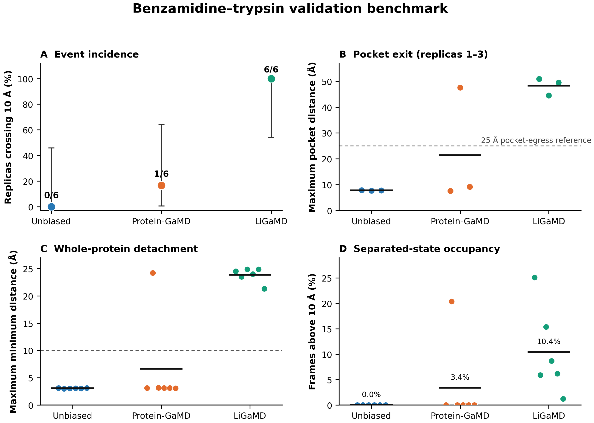

# Benzamidine–trypsin validation benchmark

This benchmark is repository evidence that the LiGaMD dual-boost implementation enhances ligand-egress sampling relative to conventional MD and protein-only GaMD. It is not presented as an independent mechanistic paper or as a physical-rate calculation.

## Result

Six independent replicas were analyzed for each method over the common 70–500 ns production window.

| Method | Replicas crossing 10 Å | Mean occupancy above 10 Å |
|---|---:|---:|
| Unbiased MD | 0/6 | 0.0% |
| Protein-GaMD | 1/6 | 3.4% |
| LiGaMD dual boost | 6/6 | 10.4% |

The incidence ranking remains 0/6, 1/6, and 6/6 when the minimum ligand–protein distance cutoff is changed from 10 Å to 8 Å or 6 Å. Two-sided Fisher exact tests give *p*=0.0022 for unbiased MD versus LiGaMD and *p*=0.0152 for protein-GaMD versus LiGaMD. With six replicas per method, these values support a clear validation signal but are not a substitute for broader validation.

For replicas 1–3, an independent ligand-to-pocket distance reaches 44.5–51.0 Å in every LiGaMD replica and 47.6 Å in protein-GaMD replica 2, while all unbiased replicas remain below 7.9 Å. This confirms exit from the S1 pocket rather than a result caused only by the whole-protein contact cutoff.



## Interpretation limits

- The minimum ligand–protein distance is a whole-protein detachment coordinate. A ligand can leave S1 and subsequently touch the exterior protein surface.
- A return below 10 Å is therefore a surface re-contact, not necessarily pocket rebinding.
- Raw GaMD/LiGaMD simulation time is biased. These data do not establish a physical residence time or `koff`.
- A complete thermodynamic validation requires boost-distribution diagnostics, reweighting convergence, and free-energy agreement with the reference LiGaMD implementation.
- Protein RMSD/RMSF, Asp189 salt-bridge occupancy, hydration, and pathway clustering require the original trajectories and should be reported separately when available.

## Figures and data

- `figures/all_replica_traces.*` — all 18 production traces as small multiples.
- `figures/benchmark_summary.*` — incidence, pocket-distance validation, maximum whole-protein separation, and occupancy.
- `figures/robustness_controls.*` — cutoff sensitivity and boost-potential control.
- `data/replica_summary.csv` — exact replica-level summaries calculated from the original 0.1 ns series.
- `data/contact_distance_traces_0p2ns.csv` — retained production traces at 0.2 ns plotting resolution.
- `data/threshold_sensitivity.csv` and `data/boost_summary.csv` — supporting control data.

Each figure is provided as PNG, editable SVG, and vector PDF.

## Reproduce the figures

From this directory:

```bash
python make_figures.py
```

The plotting script requires NumPy and Matplotlib.

## Recommended use

Use this benchmark as implementation validation in the repository, release notes, or a software paper. A standalone scientific benchmark paper would require additional protein–ligand systems, conventional structural controls, pathway characterization, and reweighted thermodynamic or kinetic validation.
